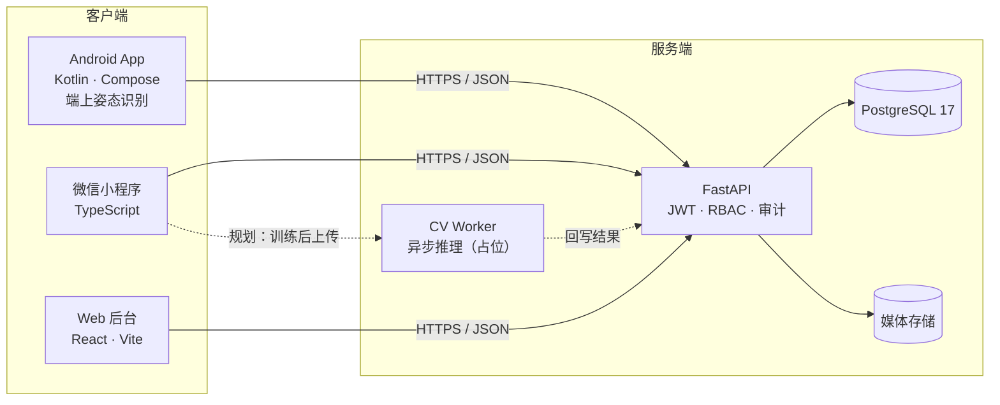

# rehab-trainer

[](https://github.com/Bandersnatch0x/rehab-trainer/actions/workflows/ci.yml)


> 帕金森病患者肌肉保护训练系统：治疗师确认分期并开具处方，患者在手机或平板完成训练，
> 姿态识别提供动作计数、步态指标与姿势矫正反馈；照护者经微信小程序查看记录、提交自评、
> 接收预警；照护管理员在 Web 后台完成随访管理。

## 目录

- [系统概览](#系统概览)
- [核心能力](#核心能力)
- [架构](#架构)
- [当前状态](#当前状态)
- [安全与合规](#安全与合规)
- [验证](#验证)
- [仓库结构](#仓库结构)
- [文档入口](#文档入口)
- [开工](#开工)

## 系统概览

| 端 | 职责 |
| --- | --- |
| **Android App**（手机 + 平板） | 全功能客户端。姿态识别端上实时推理、视频离线预缓存、采集条件检查；手机为主设备，平板为兼容设备 |
| **微信小程序** | 契约客户端与五个业务页面。姿态识别规划为云端异步推理（训练后出报告），本轮未启动（D26），无实时反馈 |
| **Web 后台** | 照护管理员的档案、看板、预警中心、随访台账、权限管理；康复治疗师的分期确认与处方工作台 |

App 与小程序的功能清单一致，差异只在姿态识别的实现方式与实时性。

### 训练范围

- **四大训练类**：牵伸放松、肌力维持、节律步态、姿势矫正。
- **每条训练包含**：视频、节拍音频、时长与频次、禁忌提示、危险信号提示。
- **分期**：按 H-Y 1–5 级建档，训练方案分 1–4 级四套；5 级仅宣教与转诊，不进训练流程。
  未经康复治疗师确认的分期标记为「疑似」。

## 核心能力

- **端上实时识别**：MediaPipe 关键点在设备侧推理，覆盖踏步、微蹲、坐位抬腿、牵伸、姿势保持与抬举；
  含相机横滚补偿、个人幅度校准、第二人入镜冻结。
- **离线优先**：视频预缓存；训练记录先落本地队列，联网后按 `clientRecordId` 幂等补传，
  失败走指数退避；拒绝与归属异常进入隔离区，可在记录页人工重试。
- **临床安全闸门**：过期处方不可开始训练；H-Y 3–4 级禁无支撑站立；分级确认必须显式选择；
  阈值未签核前自动预警与风险分级保持关闭。
- **契约先行**：OpenAPI 为唯一真源，生成 TypeScript 与 Kotlin 客户端；契约联调覆盖 32 项操作。
- **可交付运维**：健康/就绪探针、审计日志、Alembic 迁移、备份恢复演练、容器化与 CI 全量门禁。

## 架构



- 三端只通过版本化契约访问后端，不共享数据库与内部模型。
- 媒体当前落本地静态根；生产替换为对象存储 + 签名 URL（P3-7）。
- 云端 CV 未启动（D26），`services/cv-worker` 仅为占位。

## 当前状态

需求基线已裁决（见 `.agent/keep/decisions/`），演示版全链路可运行。最近一次本地验证：2026-11-10。

| 部分 | 状态 |
| --- | --- |
| 后端 `services/api` | FastAPI + SQLAlchemy；Alembic 迁移 head `0005`，覆盖 18 张表；**170 项测试通过** |
| Web 后台 `apps/admin-web` | 10 个业务页已接真实 API（患者、详情、分期、处方、预警、随访台账、审计、科研、视频管理、账号安全）；**29 条 E2E**（最近一次全量记录，11-09 后未全量复跑） |
| Android App | 端上实时推理已用于训练页动作计数；登录/绑定、真实方案、训练记录补传闭环已落地；**215 项单测通过** |
| 微信小程序 | 契约客户端与五个业务页面；**17 项测试通过**；云端异步 CV 未实现（占位见 `services/cv-worker`，D26） |
| 契约联调 | `scripts/smoke-api.py` 覆盖 **32 项契约操作**（27 个路径），含审计、科研聚合与媒体上传/上架 |
| 部署 | `services/api/Dockerfile` + `docker-compose.yml` + `deploy/`（Alembic、健康检查、自检）；手册见 `docs/deployment/README.md` |

演示版对未裁决与待临床签核内容使用 mock 并标注（D21）；步态指标在完成标定前不进训练成绩（D23）。
临床阈值与剂量目前均为文献预设，**未经专业签核**，自动预警与风险分级保持关闭。

## 安全与合规

- **身份与权限**：JWT + 角色绑定（康复治疗师 / 照护管理员 / 患者 / 照护者）；管理端写操作按角色门控，跨机构访问被拒绝并记审计。
- **审计与追溯**：登录、绑定、处方、分级、权限与媒体上下架等敏感操作落审计日志；训练记录按 `clientRecordId` 幂等，重复上传不产生重复数据。
- **数据最小化**：科研接口只输出聚合结果，小样本格做二次抑制；行级导出需另行授权与脱敏。
- **临床边界**：系统不输出诊断与治疗建议；自动预警、风险分级在专业签核前关闭；过期处方与超范围分级被服务端拦截。
- **合规状态**：医疗器械分类界定尚未完成，取得书面意见前不对外声称治疗功效；伦理审查与知情同意要件见 `docs/clinical/ethics-compliance.md`。

## 验证

```powershell
# 一把跑完所有本地门禁（失败即停）
services/api/.venv/Scripts/python.exe scripts/verify_all.py

# 后端单测
services/api/.venv/Scripts/python.exe -m pytest services/api/tests

# Android 单测
cd apps/android; ./gradlew :app:testDebugUnitTest

# 小程序类型检查与单测
pnpm --filter @rehab-trainer/miniprogram typecheck
pnpm --filter @rehab-trainer/miniprogram test

# 管理端类型检查与 E2E（E2E 自动起后端与预览服务；优先用 services/api/.venv 的 python）
cd apps/admin-web; npx tsc --noEmit
# 默认端口 18765/4173，被占用时用 E2E_BACKEND_PORT / E2E_PREVIEW_PORT 覆盖
npx playwright test

# 契约联调（不加 --base-url 时脚本自建独立库并拉起 uvicorn）
# 配置文件格式：{"username":"therapist","password":"<seed 输出>","bindingToken":"<seed 输出>"}
services/api/.venv/Scripts/python.exe scripts/smoke-api.py --config .agent/tmp/smoke-config.json

# 部署静态自检
services/api/.venv/Scripts/python.exe deploy/verify.py

# 容器与真实 PostgreSQL（需 Docker；先在 .agent/tmp/deployment.env 填好秘密）
docker compose --env-file .agent/tmp/deployment.env up --build -d --wait
```

## 仓库结构

| 路径 | 用途 |
| --- | --- |
| `apps/` | 三端应用：Android、微信小程序、Web 后台 |
| `services/` | 服务：API（FastAPI）、云端 CV 推理（占位） |
| `packages/` | API 契约与生成客户端（TypeScript / Kotlin） |
| `docs/agents/` | 工作流、执行配方、票据惯例、领域文档消费规则 |
| `docs/architecture/` | 架构与仓库结构说明 |
| `docs/clinical/` | 临床阈值文献预设与签核清单（待签核） |
| `docs/delivery/` | 用户手册、部署与运维手册、验收与合规说明、需求规格、功能矩阵、客户交付包 |
| `docs/design/` | 设计系统与交互原型 |
| `.agent/keep/` | 持久区：票据、决策、术语表（入版本控制） |
| `.agent/tmp/` | 临时产物（忽略） |
| `.agents/` | 本地面：个人过程记录与装配的技能（忽略；`skills/` 子树随仓分发） |

## 文档入口

| 文档 | 位置 |
| --- | --- |
| 需求基线与范围 | `docs/architecture/charter.md` |
| 功能矩阵（验收依据 v1.1） | `docs/delivery/feature-matrix.md` |
| 验收报告 | `docs/delivery/acceptance-report.md` |
| 临床阈值与签核清单 | `docs/clinical/literature-presets.md` |
| 伦理与合规要件 | `docs/clinical/ethics-compliance.md` |
| 用户操作手册 | `docs/delivery/user-manual.md` |
| 部署与运维 | `docs/deployment/README.md`、`docs/delivery/operations-manual.md` |
| 后续待办与待决策 | `docs/delivery/next-actions.md`、`docs/delivery/open-decisions.md` |

## 开工

1. 读 [`AGENTS.md`](AGENTS.md)，按「开工前指针」加载规则、票据与术语表。
2. 工作流入口：[`.agents/skills/agent-workflow/SKILL.md`](.agents/skills/agent-workflow/SKILL.md)。
3. 交付门禁、提交流程与验收规程以 `AGENTS.md` 的「门禁」「验收」两段为准。
