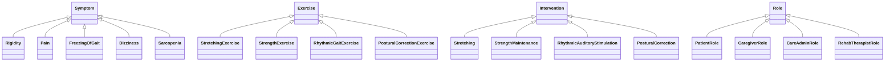

# 领域本体与 SHACL 约束

本目录是 D16 的落地物：用 OWL 2 表达领域语义，用 SHACL 表达业务硬约束。
术语以 `.agent/keep/glossary.md` 为唯一权威；决策以
`.agent/keep/decisions/0001-需求基线与范围裁决.md` 为准。

## 文件

| 文件 | 用途 |
| --- | --- |
| `rehab.ttl` | OWL 2 本体（Turtle），七个概念域 |
| `shapes.ttl` | SHACL 形状，覆盖九类必选业务约束与配套一致性约束 |
| `validate.py` | rdflib + pyshacl 校验脚本 |
| `examples/valid-minimal.ttl` | 合法最小实例 |
| `examples/valid-alert-event.ttl` | 合法预警实例 |
| `examples/valid-account.ttl` | 合法身份、绑定码与设备会话实例 |
| `examples/valid-notification-delivery.ttl` | 合法投递实例（主通道失败 + 兜底） |
| `examples/invalid-*.ttl` | 各类违规实例（共 9 个） |

## 命名空间

| 前缀 | IRI | 说明 |
| --- | --- | --- |
| `rt:` | `https://rehab-trainer.local/ontology#` | 本体术语 |
| `rtsh:` | `https://rehab-trainer.local/shapes#` | SHACL 形状 |
| `ex:` | `https://rehab-trainer.local/ontology/examples#` | 示例实例 |
| `sh:` | `http://www.w3.org/ns/shacl#` | SHACL 词汇 |
| `xsd:` | `http://www.w3.org/2001/XMLSchema#` | 数据类型 |

本体 IRI：`https://rehab-trainer.local/ontology`，版本 `0.1.0`。

## 类层级概览

```mermaid
flowchart TB
    subgraph PD[患者域]
        Patient
        HYStage
        StageConfirmation
        Assessment
        Symptom
        Organization
    end
    subgraph TD[训练域]
        Exercise
        ExerciseCategory
        Movement
        DifficultyVariant
        Dosage
    end
    subgraph BD[身体域]
        BodyPart
        Joint
        Landmark
        MovementPattern
    end
    subgraph RD[风险域]
        Contraindication
        DangerSignal
        AlertRule
        FallRisk
        RiskLevel
    end
    subgraph ID[干预域]
        Intervention
        RhythmicAuditoryStimulation
        Stretching
        StrengthMaintenance
        PosturalCorrection
    end
    subgraph RLD[角色域]
        Role
        PatientRole
        CaregiverRole
        CareAdminRole
        RehabTherapistRole
    end
    subgraph REC[记录域]
        SessionRecord
        AssessmentRecord
        AlertEvent
        Prescription
        NotificationDelivery
        DeliveryStatus
    end
    subgraph IDN[身份域]
        Account
        ExternalIdentity
        BindingToken
        DeviceSession
    end

    Patient -->|hasHYStage| HYStage
    Patient -->|hasStageConfirmation| StageConfirmation
    Patient -->|hasAssessment| Assessment
    Patient -->|hasSymptom| Symptom
    Patient -->|belongsToOrg| Organization
    Patient -->|hasPrescription| Prescription
    Patient -->|hasFallRisk| FallRisk

    Prescription -->|prescribedBy| RehabTherapistRole
    Prescription -->|referencesExercise| Exercise
    Prescription -->|prescribedDosage| Dosage
    Exercise -->|inCategory| ExerciseCategory
    Exercise -->|hasMovement| Movement
    Exercise -->|hasVariant| DifficultyVariant
    Exercise -->|hasDefaultDosage| Dosage
    Exercise -->|targetsBodyPart| BodyPart
    Exercise -->|targetsJoint| Joint
    Exercise -->|contraindicatedFor| Symptom
    Exercise -->|contraindicatedFor| Contraindication
    Exercise -->|hasDangerSignal| DangerSignal
    Exercise -->|realizesIntervention| Intervention
    Movement -->|involvesJoint| Joint
    Movement -->|involvesBodyPart| BodyPart
    Movement -->|usesLandmark| Landmark
    Movement -->|hasMovementPattern| MovementPattern
    SessionRecord -->|recordsPrescription| Prescription
    AssessmentRecord -->|recordsAssessment| Assessment
    AlertEvent -->|triggeredByRule| AlertRule
    AlertEvent -->|alertFor| Patient
    Symptom -->|triggersAlert| AlertRule
    FallRisk -->|hasRiskLevel| RiskLevel

    Account -->|accountBelongsToOrg| Organization
    Account -->|hasRoleBinding| Role
    Account -->|hasExternalIdentity| ExternalIdentity
    DeviceSession -->|deviceBoundToPatient| Patient
    DeviceSession -->|accountOfDeviceSession| Account
    BindingToken -->|bindingTargetPatient| Patient
    NotificationDelivery -->|deliveryForAlert| AlertEvent
    NotificationDelivery -->|deliveryChannel| DeliveryChannel
    NotificationDelivery -->|deliveryStatus| DeliveryStatus
```



子类树：



## 校验方法

### 1. 建虚拟环境

PowerShell（本机主用）：

```powershell
python -m venv .agent/tmp/ontology-venv
.\.agent\tmp\ontology-venv\Scripts\python.exe -m pip install rdflib pyshacl
```

Bash（Linux/macOS/WSL）：

```bash
python -m venv .agent/tmp/ontology-venv
.agent/tmp/ontology-venv/bin/python -m pip install rdflib pyshacl
```

Windows Git Bash 使用 `Scripts/python.exe`。

### 2. 用 rdflib 解析本体

```powershell
.\.agent\tmp\ontology-venv\Scripts\python.exe -c "from rdflib import Graph; g=Graph(); g.parse('docs/ontology/rehab.ttl', format='turtle'); print(len(g), 'triples')"
```

### 3. 校验单个实例

```powershell
.\.agent\tmp\ontology-venv\Scripts\python.exe docs/ontology/validate.py docs/ontology/examples/valid-minimal.ttl
```

通过时退出码为 0；违规时退出码为 1，并逐条打印 focus、path、source、message。
把违规实例纳入自动化时用 `--expect violation`：

```powershell
.\.agent\tmp\ontology-venv\Scripts\python.exe docs/ontology/validate.py --expect violation docs/ontology/examples/invalid-hy5-prescription.ttl
```

### 4. 跑全部实例

```powershell
.\.agent\tmp\ontology-venv\Scripts\python.exe docs/ontology/validate.py --suite docs/ontology/examples
```

`valid-*` 期望通过，`invalid-*` 期望违规；任何不一致都会返回 1。

### 5. 不用脚本，直接调 pyshacl

```python
from rdflib import Graph
from pyshacl import validate

data = Graph().parse("docs/ontology/examples/valid-minimal.ttl", format="turtle")
shapes = Graph().parse("docs/ontology/shapes.ttl", format="turtle")
ontology = Graph().parse("docs/ontology/rehab.ttl", format="turtle")

conforms, report_graph, report_text = validate(
    data,
    shacl_graph=shapes,
    ont_graph=ontology,
    inference="rdfs",
)
print(conforms)
print(report_text)
```

默认推理用 `rdfs`；需要 OWL RL 时给 `validate.py` 加 `--inference owlrl`。
SHACL-SPARQL 约束由 pyshacl 执行，无需额外插件。

说明：默认的 `rdfs` 推理不会物化 `owl:inverseOf` 的逆向三元组。示例同时写出双向关系
（如 `rt:hasStageConfirmation` / `rt:confirmsPatient`）；若数据只写单向，请改用
`--inference owlrl`，或补写反向关系。

## 如何新增一个训练条目

1. **选训练大类**：四类固定，不能新增。
   - 牵伸放松 → `rt:StretchingExercise`
   - 肌力维持 → `rt:StrengthExercise`
   - 节律步态 → `rt:RhythmicGaitExercise`
   - 姿势矫正 → `rt:PosturalCorrectionExercise`
2. **填必填属性**（缺一项会被 `rtsh:ExerciseSafetyShape` 拒绝）：

   | 属性 | 取值 | 说明 |
   | --- | --- | --- |
   | `rt:exerciseCode` | `xsd:string` | 唯一条目标识 |
   | `rt:inCategory` | 四个 `rt:cat*` 之一 | 必须与子类一致 |
   | `rt:hasPublicationStatus` | `rt:Draft` / `rt:Published` / `rt:Retired` | 处方只能引用 `Published` |
   | `rt:hasRiskLevel` | `rt:LowRisk` / `rt:MediumRisk` / `rt:HighRisk` | 高风险准入受 D11 约束 |
   | `rt:applicableToStage` | `rt:HYStage1`–`rt:HYStage4` | 不得包含 `rt:HYStage5` |
   | `rt:targetsBodyPart` | `rt:BodyPart` 个体 | 目标身体部位 |
   | `rt:targetsJoint` | `rt:Joint` 个体 | 目标关节（建议填） |
   | `rt:hasMovement` | `rt:Movement` 个体 | 动作必须声明 `rt:hasSupportLevel` |
   | `rt:hasDefaultDosage` | `rt:Dosage` 个体 | 组数、次数、时长必填；BPM 按 C3 配置 |
   | `rt:contraindicatedFor` | `rt:Symptom` 或 `rt:Contraindication` | 至少一条 |
   | `rt:hasDangerSignal` | `rt:DangerSignal` 个体 | 至少一个 |
   | `rt:videoUri` / `rt:audioUri` | `xsd:anyURI` | 可选，建议填 |
3. **加 2–3 个难度变体**：`rt:DifficultyVariant`，填 `rt:variantOf`、`rt:variantLevel`（1–3）、
   `rt:applicableToStage`、`rt:hasDefaultDosage`、`rt:hasPublicationStatus`。
4. **检查安全分界**：若 `applicableToStage` 含 `rt:HYStage3` 或 `rt:HYStage4`，
   所有关联 `Movement` 的 `rt:hasSupportLevel` 不得是 `rt:UnsupportedStanding`。
5. **跑校验**：

   ```powershell
   .\.agent\tmp\ontology-venv\Scripts\python.exe docs/ontology/validate.py --expect conform your-exercise.ttl
   ```

6. **发布**：状态改成 `rt:Published` 后，处方才可引用；发布前保持 `rt:Draft`。

模板：

```turtle
ex:exerciseNew a rt:StretchingExercise ;
    rt:exerciseCode "STR-002" ;
    rt:inCategory rt:catStretchingRelaxation ;
    rt:hasPublicationStatus rt:Draft ;
    rt:hasRiskLevel rt:LowRisk ;
    rt:applicableToStage rt:HYStage1, rt:HYStage2 ;
    rt:targetsBodyPart rt:LowerLimb ;
    rt:targetsJoint rt:KneeJoint ;
    rt:hasMovement ex:movementNew ;
    rt:hasDefaultDosage ex:dosageNew ;
    rt:contraindicatedFor ex:pain1 ;
    rt:hasDangerSignal ex:danger1 .
```

## 与 glossary.md 的对应关系

| 术语表条目 | 本体 IRI | 中文标签 | 说明 |
| --- | --- | --- | --- |
| H-Y 分级 | `rt:HYStage` | H-Y 分级 | 五级个体 `rt:HYStage1`–`5` |
| 分期确认 | `rt:StageConfirmation` | 分期确认 | 尚未确认用 `rt:Suspected` |
| 训练条目 | `rt:Exercise` | 训练条目 | 数据实体 `Exercise` |
| 训练大类 | `rt:ExerciseCategory` | 训练大类 | 四个体固定 |
| 处方 | `rt:Prescription` | 处方 | 治疗师签发 |
| 训练记录 | `rt:SessionRecord` | 训练记录 | 含 T7 版本字段 |
| 节律性听觉刺激 | `rt:RhythmicAuditoryStimulation` | 节律性听觉刺激 | 缩写 RAS |
| 冻结步态 | `rt:FreezingOfGait` | 冻结步态 | 不做自动检测 |
| 姿势矫正 | `rt:PosturalCorrection` | 姿势矫正 | 干预类；训练子类 `rt:PosturalCorrectionExercise` |
| 康复治疗师 | `rt:RehabTherapistRole` | 康复治疗师 | 处方权唯一持有者 |
| 照护管理员 | `rt:CareAdminRole` | 照护管理员 | 机构侧账号 |
| 风险预警 | `rt:AlertEvent` | 风险预警 | 规则是 `rt:AlertRule` |
| 照护者 | `rt:CaregiverRole` | 照护者 | 可代操作（D4） |
| 患者 | `rt:Patient` / `rt:PatientRole` | 患者 | 主体档案 vs 账号角色 |
| 动作计数 / 步态指标 | 无独立类 | — | 运行时指标，由 `rt:metricAlgorithmVersion` 承载版本口径 |

## 约束清单

| 约束 | SHACL 形状 | 决策来源 |
| --- | --- | --- |
| H-Y 5 级患者不得被分配训练方案 | `rtsh:HY5NoPrescriptionShape` | D5 |
| 训练条目必须有 `contraindicatedFor` 与 `hasDangerSignal` | `rtsh:ExerciseSafetyShape` | 说明书模块 2 |
| H-Y 3–4 级不得使用无支撑站立类动作 | `rtsh:Stage34NoUnsupportedStandingShape` | 说明书安全逻辑 |
| 处方必须由 `RehabTherapistRole` 签发，且记录签发时间与版本 | `rtsh:PrescriptionShape` | D12 |
| 训练记录必须携带模型版本与指标算法版本 | `rtsh:SessionRecordShape` | T7 |
| 分期未确认时不得用于高风险训练准入 | `rtsh:HighRiskAdmissionRequiresConfirmedStageShape` + `rtsh:PatientShape` | D11 |
| 分期确认记录与患者当前分期/确认人一致 | `rtsh:StageConfirmationConsistencyShape` | D11 |
| 处方引用的训练条目必须存在且状态为已发布 | `rtsh:PrescriptionShape` + `rtsh:PublishedExerciseShape` | C1/C2 |
| 患者必须属于且仅属于一个 `org` | `rtsh:PatientShape` | D10 |
| 警觉记录必须有触发规则与时间戳 | `rtsh:AlertEventShape` | D6 |

## 无法形式化、需要运行时实现的部分

- **C5 时间窗口**：连续 3 天、2 周、≥3 次/周、≥2 次/年这类跨事件窗口无法用 OWL 表达。
  SHACL 只能校验单张数据图，不能保留事件历史。本体只用 `rt:windowDays` /
  `rt:thresholdMinutes` 建模配置字段并标注「待签核」，实际判定必须由运行时规则引擎或
  定时任务完成。
- **D10 跨机构访问控制**：SHACL 能校验「患者只属于一个 org」，但「机构 A 的管理员访问
  机构 B 患者时返回 403 并写审计」是请求期授权，必须在 API 中间件与审计日志中实现。
- **D13 有效性阈值**：关键点可见率、动作幅度、有效帧占比、时长异常的阈值尚未实测
  （未决项 12），只能作为运行时配置，不能写成公理。
- **C3 BPM 个体化**：基线步频 × 1.0–1.1、兜底 60–130、不按 H-Y 调整、一拍一步；
  这是待临床签核的算法配置，本体只保留 `rt:bpm` 字段。
- **C4 量表分界值**：SARC-F ≥4、SARC-CalF ≥11、TUG ≥11.5s、STEADI、Short FES-I；
  本体只建量表标识与 `rt:severity`，不写分界值。
- **C2 分期→条目映射表内容**：映射表本身尚未签核（未决项 2）。本体只要求处方记录
  `rt:usesMappingTableVersion`，不固化映射内容。
- **T7 跨版本趋势比较**：SHACL 能要求版本字段存在，但不能阻止报表层把不同版本的记录
  当同口径比较；须在查询/报告层加版本差异提示。
- **D9 设备绑定、D6 预警送达、D4 所有写操作的 actor/subject**：这些是运行时状态与
  审计要求；本体负责字段与关系，执行在应用层。

## 临床签核边界

以下内容尚未签核，本体与形状都没有把它们写成数值公理：

- H-Y 归属与映射、每条目禁忌与危险信号、剂量与进阶退阶规则；
- 四个量表的选择与分界值、四类预警阈值、跌倒分层与活动限制；
- BPM 个体化规则、逐条视频动作正确性、5 级仅宣教边界、急症红 flag 与升级路径。

签核完成后，优先改 `shapes.ttl` 或独立配置，不要把未签核数值写进 `rehab.ttl` 的
OWL 公理。`rehab.ttl` 中相关字段的注释均标了「待临床签核」。

## 验证记录

在 `.agent/tmp/ontology-venv/`（Python 3.13）安装 `rdflib` + `pyshacl` 后实际运行：

```text
PASS invalid-exercise-missing-contraindication.ttl: 期望 violation，实际 NON-CONFORMS，1 条结果
PASS invalid-hy5-prescription.ttl: 期望 violation，实际 NON-CONFORMS，1 条结果
PASS invalid-patient-two-orgs.ttl: 期望 violation，实际 NON-CONFORMS，1 条结果
PASS invalid-prescription-unpublished-exercise.ttl: 期望 violation，实际 NON-CONFORMS，2 条结果
PASS invalid-session-missing-versions.ttl: 期望 violation，实际 NON-CONFORMS，2 条结果
PASS invalid-stage34-unsupported-standing.ttl: 期望 violation，实际 NON-CONFORMS，1 条结果
PASS invalid-unconfirmed-high-risk.ttl: 期望 violation，实际 NON-CONFORMS，1 条结果
PASS valid-alert-event.ttl: 期望 conform，实际 CONFORMS，0 条结果
PASS valid-minimal.ttl: 期望 conform，实际 CONFORMS，0 条结果

汇总：9/9 通过
```

`invalid-prescription-unpublished-exercise.ttl` 报 2 条结果，分别聚焦处方和草稿条目，
是 `sh:node` 与内层 `PublishedExerciseShape` 的预期双层报告；
`invalid-session-missing-versions.ttl` 报 2 条结果，对应缺失的模型版本与指标算法版本。

## 变更约定

- 改本体术语或语义：递增 `owl:versionInfo`，跑全量套件。
- 改业务约束：改 `shapes.ttl`，递增 shapes 的 `owl:versionInfo`，补对应 `examples/invalid-*.ttl`。
- 不修改 `.agent/keep/` 下的术语表与决策记录；术语冲突时先改术语表或走裁决，不在本体里静默漂移。
